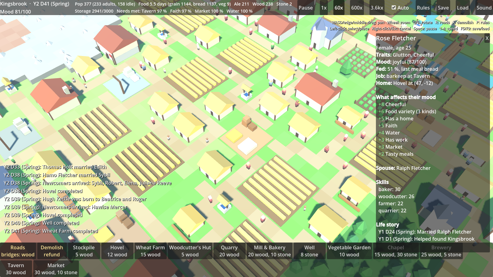

# Medieval City Builder

A persistent, multiplayer medieval city-builder and RTS that runs on a dedicated server. Cities grow over weeks and sieges last days. It looks like classic isometric castle-builders, and its colony simulation takes its depth from games like Dwarf Fortress and Songs of Syx.

The full design and roadmap are in [docs/DESIGN.md](docs/DESIGN.md).

## Status: Phase 1, first playable client

The game rules live in a plain C# library (`src/Sim.Core`) that the Godot client and the future dedicated server share. The client in `client/` draws the simulation and lets you play it.

What works today:
- **An endless procedural world.** The map is generated in 64×64 chunks from a seed, with grassland, fertile river valleys, forest, rock, iron deposits, lakes and rivers. Chunks are created only when something looks at them, and the result doesn't depend on the order they were visited.
- **Time.** One game day is one real hour (240 ticks of 6 game minutes each), with seasons and years. Every duration is written in game days, so the time scale is one constant.
- **Citizens.** Each person is a real record: name, age, sex, family, traits, skills that improve with work, job, home, hunger, mood and a life history.
- **Jobs.** People are assigned by settlement rules (job priorities). The rules give priority to food during shortages, to producers of scarce goods, and to builders.
- **Production chains** defined in JSON: farm → grain, then mill & bakery → bread; vegetable garden → vegetables; brewery: grain → ale; woodcutter → wood; quarry → stone. They respect stock reserves and stock limits (like Dwarf Fortress work orders), and workers are freed once stores are full.
- **Construction.** Buildings wait for materials, then builders put them up. Placement rules check terrain and nearby forest or rock.
- **Roads and logistics.** Each workplace loses time to hauling, based on the real walking cost to the nearest stockpile. Roads make that cheaper; rivers and buildings make people go around. Buildings with no walkable route are flagged.
- **Bridges.** Roads can cross water as wooden bridges (4 wood per tile). The governor builds them to reach land across rivers.
- **Growing territory.** A settlement may build within a radius that grows with its population (44 tiles at the start, up to 100).
- **Save and load.** A versioned JSON format. Terrain is regenerated from the seed, and everything else is stored, so a loaded game continues exactly as it would have.
- **Demolition.** Buildings and roads can be torn down for a partial refund (half while under construction, a quarter once finished).
- **Services** (Songs of Syx-style): wells (water), chapels (faith), taverns (drink, which uses ale) and markets each serve homes within a radius, up to a capacity, and most need staff.
- **Needs and mood.** Mood comes from meals (bread beats raw grain), food variety (a market lets people shop around), each service need, housing, work, traits and hunger. The inspector lists every factor. Starvation kills.
- **Life events.** Ageing, marriage, births, deaths, newcomers arriving when the town thrives, and unhappy people leaving.
- **A governor AI** grows the town automatically, using the same commands a player would: housing, food, materials, and services where homes aren't covered. It lays roads to each new building and avoids sites people can't reach. This is the seed of the NPC faction AI.
- **Deterministic.** The same seed always produces the same world. A state hash proves it, and the tests check it.

## Running it

You need the [.NET 8 SDK](https://dotnet.microsoft.com/download).

Simulate 100 game days and print a weekly report:

```bash
dotnet run --project src/Sim.Console -- --days 100
```

Print the town map at the start and end, a daily report, and every citizen at the end:

```bash
dotnet run --project src/Sim.Console -- --seed 7 --days 200 --report daily --map --citizens
```

Run at real speed, sped up 60× (one game day per real minute):

```bash
dotnet run --project src/Sim.Console -- --realtime 60
```

Run the tests:

```bash
dotnet test
```

## Running the game client (Phase 1)



### What to download

| Tool | Link | Notes |
|---|---|---|
| **Godot 4.7.2, .NET edition** | https://godotengine.org/download/archive/4.7.2-stable/ | Get the **.NET** build, not the standard one. The project is pinned to 4.7.2. |
| **.NET 8 SDK** | https://dotnet.microsoft.com/download/dotnet/8.0 | Needed by Godot .NET, the simulation and the tests. |
| **Git** | https://git-scm.com/downloads | Optional GUI: GitHub Desktop, https://desktop.github.com |
| **Code editor** | VS Code (https://code.visualstudio.com) with the C# Dev Kit extension, Visual Studio Community (https://visualstudio.microsoft.com/vs/community/), or JetBrains Rider (https://www.jetbrains.com/rider/, free for non-commercial use) | Any of these works with Godot C#. |
| *Later:* Blender | https://www.blender.org/download/ | For your own low-poly models. Free CC0 placeholder art: https://kenney.nl/assets, https://quaternius.com |

### Opening it

1. Clone this repository.
2. Start Godot, click **Import**, and select `client/project.godot`.
3. Press **F5** (or the ▶ Play button). The first run builds the C# code, which takes a moment.

### Controls

| Input | Action |
|---|---|
| WASD / arrow keys / screen edge / middle-drag | Pan |
| Mouse wheel | Zoom |
| Q / E | Rotate the view 90° |
| Left-click | Select a building or citizen, or place a building |
| R | Road tool: click the start, then click the end (lays an L-shaped road; over water it builds a bridge) |
| X | Demolish tool: click a building or road tile |
| T | Territory tool: drag to claim land, Shift+drag to give it back, `[` / `]` change the brush size |
| J | Trade panel: market, your offers, new offer (with a fair-price button), routes and caravans. Needs a Trading Post |
| Right-click / Esc | Cancel the current tool or close the inspector |
| P | Rules panel: job priorities, stock limits, reserves |
| F5 / F9 | Quick-save / load (saved in Godot's user data folder) |
| M | Sound on/off |
| Space | Pause |
| 1–4 | Speed: 1× (real time, 1 game day per hour), 60×, 600×, 3600× |

The bottom bar places buildings and starts the Roads and Demolish tools: a green ghost means the spot is valid, and red shows the reason it isn't. Service buildings show their reach as a yellow diamond. Placed buildings wait for materials, go up inside a scaffold, then start working. **Auto-build** lets the town's governor keep building on its own.

Territory is the land you may build on. You choose where it goes by painting it (T), so you can grow along one bank of a river or up to a mountain and no further. How much you may hold grows with population, up to the cap of your town centre. Select the Keep and upgrade it to a Town Hall, then a Castle, to raise the cap. **Auto land** claims spare allowance evenly around the centre each day; turn it off to paint by hand. **Expand evenly** does the same once.

### Command-line options

These go after `--` on Godot's command line:

| Option | Effect |
|---|---|
| `--seed N` | Use a different world |
| `--warmup-days N` | Fast-forward the simulation N days before showing it |
| `--inspect` | Open the inspector on a citizen at start |
| `--screenshot out.png` | Save a screenshot after a few frames, then quit |
| `--host [PORT]` | Host a world for friends as `--name` |
| `--join HOST[:PORT]` | Join a shared world as `--name` |
| `--name NAME` | Your player name in shared worlds |
| `--world-speed PRESET` | `persistent`, `weekend`, `evening` (default) or `sprint`, for new worlds |
| `--menu` | Show the start menu even with other options (for screenshots) |
| `--rules` | Open the rules panel at start |
| `--trade [TAB]` | Open the trade panel at start (tab 0–4) |
| `--follow-caravan` | Keep the camera on a caravan on the road |
| `--territory` | Open the territory tool at start |
| `--zoom N` | Start with the camera N units away (6–90) |
| `--place ID` | Start placing building `ID` (e.g. `chapel`) with the cursor in the middle of the screen |
| `--cursor X,Y` | With `--place`, put the cursor at this pixel instead |
| `--save-load-test` | Save, reload the game from that save, and print both state hashes (they should match) |
| `--export-sounds DIR` | Write every generated sound to `DIR` as `.wav` files |

To render a screenshot without a window (the same command used for the image above):

```bash
xvfb-run -a godot --path client --rendering-driver opengl3 --rendering-method gl_compatibility --resolution 1600x900 -- --warmup-days 200 --inspect --screenshot shot.png
```

To compile-check the client without the editor:

```bash
dotnet build client/MedievalClient.csproj
```

### Trading

Build a **Trading Post**, then open the trade panel (J). Sell goods for coin, buy with coin, or barter goods for goods; **Fair price** fills in what merchants pay or charge, and you can raise it for anything you'd rather keep. Deals happen instantly, but the goods and coin travel by ox cart and arrive days later. Merchants visit every 10 days and buy anything listed at a fair price; in shared worlds you can also take other players' offers and set up standing trade routes.

### Playing with friends

From the start menu (or the command line):

- **Host:** runs the world on your computer while you play. Friends join with your address and port (default 7777; forward it on your router for friends outside your home network). The world is saved in your user folder, and **Host (continue)** picks it up next time.
- **Join:** enter a friend's address (`host` or `host:port`) or a dedicated server's.
- **World speed**, **Speed control** and **When nobody plays** are chosen when a world is created and stay with it. See `docs/DESIGN.md`.

### Dedicated server

```bash
dotnet run -c Release --project src/Sim.Server -- --world myworld.json --speed persistent --when-empty run
```

It creates `myworld.json` if it doesn't exist, listens on port 7777, autosaves every 5 minutes, and saves when stopped (Ctrl+C, `docker stop` or systemd). Options: `--port`, `--seed`, `--speed persistent|weekend|evening|sprint|<seconds per day>`, `--speed-policy fixed|host|unanimous`, `--when-empty pause|catchup|run`, `--catch-up-days N`, `--max-speed X`, `--admin NAME`, `--autosave-minutes N`. Players are identified by name only for now, so use it with friends rather than as a public server.

### Sound and art

Every sound (wind and birdsong, hammering from nearby construction, clicks, thuds, rubble, bells) and every model is generated by our own code, so the project contains no third-party assets. See [CREDITS.md](CREDITS.md) for the licences of the engine and runtime, what to include when you ship a build, and the rules for adding internet assets later.

## Project layout

| Path | Contents |
|---|---|
| `src/Sim.Core/` | The simulation. No engine code; it will be shared by the server and the Godot client. |
| `src/Sim.Core/Data/*.json` | Data-driven definitions for resources, buildings (including services) and needs. |
| `src/Sim.Core/World/` | Seeded chunk-based world generation, and the pathfinder. |
| `src/Sim.Core/Citizens/` | Citizen records and names. |
| `src/Sim.Core/Settlements/` | Settlements, buildings, settlement rules. |
| `src/Sim.Core/Systems/` | Systems that run each tick, hour or day: logistics, construction, production, jobs, housing, needs and mood, services, life events, migration. |
| `src/Sim.Core/AI/` | Site finder, road planner and settlement governor. |
| `src/Sim.Core/Commands/` | The commands players and AI use to change the world. |
| `src/Sim.Core/Simulation/` | The world state root, the simulator loop, and settlement founding. |
| `src/Sim.Core/Persistence/` | Save/load (versioned JSON). |
| `src/Sim.Net/` | Networking with no engine code: protocol, `WorldHost` (server logic), `NetClient` (keeps a world copy in step) and TCP transport. |
| `src/Sim.Server/` | The dedicated server program (`medieval-server`). |
| `src/Sim.Console/` | Headless runner with text reports and an ASCII map. |
| `tests/Sim.Tests/` | xUnit tests. |
| `client/` | Godot 4 (C#) game client: procedural low-poly terrain, water, roads, buildings and townsfolk who walk along roads, camera, HUD, building/road/demolish tools and inspector. |
| `client/Scripts/SimSession.cs` | The client's only door into the simulation: single-player, hosting or joined, plus save/load. |
| `client/Scripts/Ui/StartMenu.cs` | New world, continue, host or join. |
| `client/Scripts/Audio/` | Procedural sound synthesis and playback. |
| `client/Scripts/Ui/RulesPanel.cs` | The settlement rules panel. |

## Next steps

1. **Phase 1 depth:** housing upgrades and social classes, seasons, a town ledger screen.
2. **Phase 2, continuing:** player accounts and authentication, Steam relay for hosting without port forwarding, a Docker image for the server, and interaction between towns (trade first).
3. **Phase 3:** armies raised from townsfolk, squad battles, and generals.
